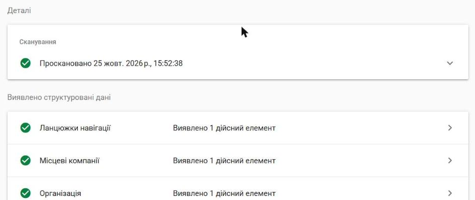

# Telegram-бот для запису клієнтів

Бот для онлайн-запису в барбершоп (легко адаптується під салон, манікюр, автосервіс тощо).

- 🤖 Бот: [@barrrber_bot](https://t.me/barrrber_bot)
- 🌐 Лендинг: [maksimka22.github.io/barber-bot](https://maksimka22.github.io/barber-bot/) (код у папці `docs/`)

## Можливості
- Вибір послуги, дня та вільного часу кнопками
- Зайняті слоти та минулий час автоматично ховаються, подвійний запис неможливий
- Номер телефону однією кнопкою або вручну (з перевіркою формату)
- «Мої записи» зі скасуванням
- Сповіщення власнику про нові та скасовані записи
- Команди власника: `/today`, `/week`

## Запуск
1. Створи бота в [@BotFather](https://t.me/BotFather) і скопіюй токен.
2. Скопіюй `.env.example` у `.env` та встав `BOT_TOKEN`.
3. Запусти `run.bat`, напиши боту `/myid` і впиши свій ID в `ADMIN_ID` у `.env`. Перезапусти.

Налаштування (назва, послуги, ціни, години роботи, вихідні) — у `config.py`.

## Сайт і локальне SEO

Сайт барбершопу оптимізовано під пошук «барбершоп Луцьк», «чоловіча стрижка Луцьк» тощо.

**Результати:**
- Google PageSpeed Insights (мобільний): **SEO 100**, доступність 100, оптимальні методи 100, ефективність 92 — [звіт](https://pagespeed.web.dev/analysis/https-maksimka22-github-io-barber-bot/b1z5vt83m1?form_factor=mobile).
- [Google Rich Results Test](https://search.google.com/test/rich-results?url=https%3A%2F%2Fmaksimka22.github.io%2Fbarber-bot%2Fposluhy%2Fstryzhka-i-boroda%2F): **3 дійсні елементи** — «Місцеві компанії», «Ланцюжки навігації», «Організація», без помилок і попереджень.



**Що зроблено на сайті:**
- місто в title, H1 і описах: «Барбершоп у Луцьку», «Чоловіча стрижка в Луцьку — 400 грн»;
- окрема сторінка для кожної послуги ([стрижка](https://maksimka22.github.io/barber-bot/posluhy/cholovicha-stryzhka/), [борода](https://maksimka22.github.io/barber-bot/posluhy/stryzhka-borody/), [комплекс](https://maksimka22.github.io/barber-bot/posluhy/stryzhka-i-boroda/)) з унікальним текстом, ціною, тривалістю й питаннями;
- блок NAP (назва, адреса, телефон) з графіком — однаковий на всіх сторінках і в розмітці;
- розмітка Schema.org: `HairSalon` (адреса, графік, ціни, каталог послуг, запис через Telegram як `ReserveAction`), `Service`, `BreadcrumbList`, `FAQPage`;
- блок «Часті питання» з відповідями на типові запити («скільки коштує стрижка в Луцьку»);
- хлібні крихти, canonical, Open Graph з картинкою для поширення в месенджерах, `sitemap.xml`;
- швидкість: стилі вбудовані в сторінку, шрифти Google вантажаться без блокування.

Сторінки збирає скрипт `tools/build_site.py` з одного набору даних (назва, адреса, ціни), тож NAP і ціни не розходяться між сторінками й розміткою:

```bash
python tools/build_site.py
```

**Що ще зробити для справжнього бізнесу (поза сайтом):**
1. Створити й заповнити профіль Google Business Profile: та сама назва, адреса й телефон, категорія «Барбершоп», графік, фото, послуги з цінами.
2. Додати бізнес у карти та каталоги (Google Maps, Apple Maps, 2GIS, місцеві довідники) з ідентичним NAP.
3. Просити клієнтів залишати відгуки в Google і відповідати на кожен.
4. Підтвердити сайт у Google Search Console і надіслати `sitemap.xml`.
5. Розмістити шрифт Playfair Display на самому сайті — це прибере останню затримку першого відображення (ефективність 92 → ~100).

> Барбершоп вигаданий, адреса й телефон — заглушки. Демо-проєкт для портфоліо.

## Стек
Python 3.12, aiogram 3, SQLite · сайт: HTML, CSS, Schema.org, генератор на Python
